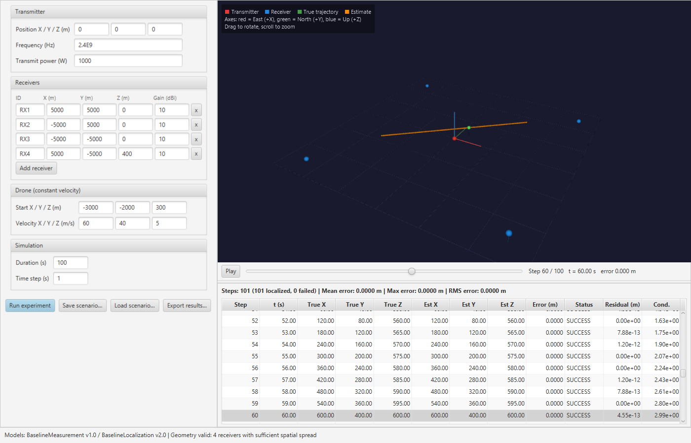

# Multi-Static Radar Simulator

Interactive simulator for 3D drone localization with one transmitter and multiple receivers, built for **Dr. Giridhar K** (Department of Electrical Engineering, IIT Madras) as a CS5013 course project.

You place a transmitter and any number of receivers, define a drone trajectory, and the simulator runs:

**configure geometry → generate trajectory → simulate measurements → estimate position → compare with ground truth → visualize and report error**

The measurement and localization models are replaceable and carry a name and version, so a new formulation can be compared against an earlier one on the same scenario.



## Quick start

Requires **JDK 17 or newer** (tested on JDK 26). No separate Gradle install is needed; the wrapper downloads Gradle 9.3.0 on first use.

```bash
git clone https://github.com/shervan0714/MultiStaticRadarSimulator.git
cd MultiStaticRadarSimulator

./gradlew run        # JavaFX simulator (use gradlew.bat on Windows)
./gradlew test       # run the test suite
./gradlew runCli     # same pipeline from the command line, no GUI
```

## Using the GUI

1. **Configure** the transmitter, the receivers (use *Add receiver* and the `x` buttons; at least 3), each receiver's facing direction (**Az** in degrees anticlockwise from East, **El** in degrees above horizontal), the drone start position and velocity, the duration and time step, and optional **range noise σ** with a **random seed** (0 = noiseless; the same seed always reproduces the same run).
2. Click **Run experiment**. The geometry is validated first: invalid layouts (too few receivers, collinear sensors, duplicate IDs) are refused with a red message, and coplanar layouts run with a warning.
3. **Inspect** the 3D view (yellow arrows show where each receiver points): drag to orbit, scroll to zoom, and use the slider or *Play* to step through time. The results table lists every step; selecting a row moves the 3D view to that step.
4. **Save scenario… / Load scenario…** store and restore the configuration (`.properties`). **Export results…** writes a per-step CSV and an evaluation summary.

The window opens with a 4-receiver default scenario already evaluated.

## Command line

```bash
./gradlew runCli --args="--receivers 4 --duration 10 --timestep 1"
./gradlew runCli --args="--save scenario.properties"
./gradlew runCli --args="--load scenario.properties --export results.csv"
./gradlew runCli --args="--receivers 4 --noise 5 --seed 42"
```

| Option | Meaning |
|---|---|
| `--receivers N` | Built-in layout with 3, 4 or 5 receivers (default 3) |
| `--duration S`, `--timestep S` | Simulation time span and sample interval in seconds |
| `--save FILE` / `--load FILE` | Save or load the scenario configuration |
| `--export FILE.csv` | Write per-step results and `FILE_summary.txt` |
| `--noise M`, `--seed N` | Gaussian range noise with standard deviation M metres, seeded with N (default: noiseless, seed 42); override values from `--load` |

## Coordinate convention

Right-handed Cartesian frame in metres with the origin at the transmitter frame origin: **+X East, +Y North, +Z Up**. The 3D view draws East as the red axis, North as green and Up as blue.

## Architecture

Each design doc module is one package under `src/main/java/com/radar/simulator/`:

| Module | Package | Main classes | Responsibility |
|---|---|---|---|
| Scenario model | `scenario`, `core` | `Scenario`, `Transmitter`, `Receiver` | Sensor positions and parameters, target trajectory |
| Trajectory engine | `scenario` | `TrajectoryModel`, `ConstantVelocityTrajectory` | Target position and velocity at time *t* |
| Measurement model | `measurement` | `MeasurementModel`, `BaselineMeasurementModel` | Per-receiver bistatic range, time delay, received power |
| Localization model | `localization` | `LocalizationModel`, `BaselineLocalizationModel` | Position estimate with status, residual and condition number |
| Geometry validation | `localization` | `GeometryValidator` | Rejects under-constrained layouts; warns about mirror ambiguity |
| Experiment runner | `experiment` | `ExperimentRunner`, `ExperimentRecord` | Runs every time step and records truth, measurement, estimate, model versions and error |
| Evaluation | `experiment` | `EvaluationModule`, `EvaluationResult` | Mean, max and RMS error; successful vs failed steps |
| Persistence | `persistence` | `ScenarioPersistence` | Scenario save/load, CSV and summary export |
| UI / visualization | `ui` | `SimulatorController`, `ScenarioEditor`, `Visualization3D`, `ResultsPanel` | Form, 3D view, results table |

[docs/PROJECT-STRUCTURE.md](docs/PROJECT-STRUCTURE.md) explains every folder and file.

Measurements are matched to receivers by **receiver ID**, so reordering receivers can never attach an observation to the wrong one. A localization result is never silently wrong: besides `SUCCESS` it can report `UNDER_CONSTRAINED`, `NUMERICALLY_UNSTABLE` or `INVALID_INPUT`.

### Baseline formulation (measurement v1.1, localization v2.1)

Until the stakeholder's formulation is available, the baseline uses bistatic range only. Each receiver *i* gives one equation

&nbsp;&nbsp;&nbsp;&nbsp;‖p − t‖ + ‖p − rᵢ‖ = mᵢ

(an ellipsoid with foci at the transmitter *t* and the receiver *rᵢ*). The position *p* is the least-squares solution found by Levenberg–Marquardt with the analytic Jacobian, started from several points; the target is constrained to be at or above the ground, which resolves the mirror solution of a (nearly) flat sensor layout. The result reports the RMS range residual and the Jacobian condition number.

The measurement model also produces each receiver's **azimuth/elevation** of the target in that receiver's own antenna frame (so orientation matters), and can add **seeded Gaussian noise** to the ranges.

## Verification

`./gradlew test` runs 131 JUnit tests covering every module in the design doc test plan:

- **Hand-computable unit cases:** vectors, 3×3 linear algebra, trajectories, measurements and error metrics.
- **Noiseless reference scenarios:** 3, 4 and 5 receivers, wide baseline, close range and an elevated transmitter. Each must reproduce ground truth within **1 mm**.
- **Degenerate geometry:** too few receivers, collinear sensors, duplicate IDs, impossible ranges and an in-plane target. Each must return an explicit status or a warning.
- **Ordering and timing:** receiver reordering, measurement time stamps, and fractional time steps.
- **Orientation:** boresight directions and receiver-frame angles for hand-checkable geometries.
- **Noise:** seeded runs are reproducible, the noise spread matches σ, and noisy estimates never flip to the mirror solution below ground.
- **Persistence round trip and CSV export.**
- **GUI logic without a display:** form-to-scenario mapping and the world-to-scene transform.

## Status

The full workflow above works end to end. Since the mid-evaluation, receiver orientation, receiver-frame angles and seeded measurement noise have been added. [docs/MID-DEMO.md](docs/MID-DEMO.md) has the mid-evaluation demo script and gap list (with which gaps are now closed), and [docs/WEEKLY-LOG.md](docs/WEEKLY-LOG.md) the change history.

## Contact

**E. Sai Shervan** (CS24B073), Department of Computer Science and Engineering, IIT Madras
cs24b073@smail.iitm.ac.in · GitHub [@shervan0714](https://github.com/shervan0714)

Stakeholder: Dr. Giridhar K, Department of Electrical Engineering, IIT Madras.
