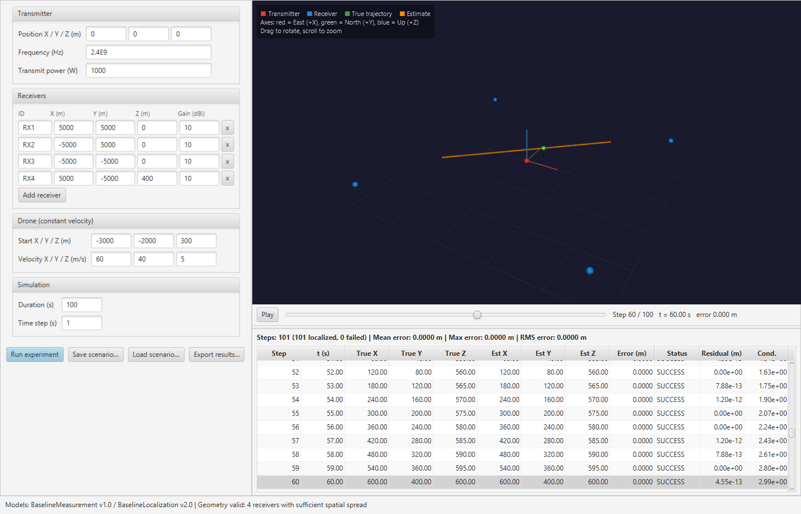
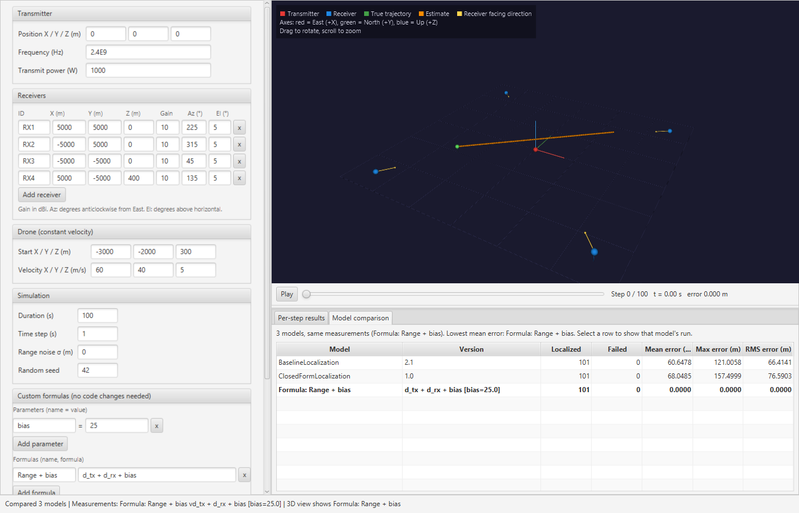

# Multi-Static Radar Simulator

Interactive simulator for 3D drone localization with one transmitter and multiple receivers, built for **Dr. Giridhar K** (Department of Electrical Engineering, IIT Madras) as a CS5013 course project.

You place a transmitter and any number of receivers, define a drone trajectory, and the simulator runs:

**configure geometry → generate trajectory → simulate measurements → estimate position → compare with ground truth → visualize and report error**

The measurement and localization models are replaceable and carry a name and version, so a new formulation can be compared against an earlier one on the same scenario.



## Quick start

Requires **JDK 17 or newer** (tested on JDK 26). No separate Gradle install is needed; the wrapper downloads Gradle 9.3.0 on first use.

```bash
git clone https://github.com/shervan0714/MultiStaticRadarSimulator.git
cd MultiStaticRadarSimulator

./gradlew run        # JavaFX simulator (use gradlew.bat on Windows)
./gradlew test       # run the test suite
./gradlew runCli     # same pipeline from the command line, no GUI
```

## Running without building (for users)

Two ready-made packages are built from the source. Neither needs Gradle or the source code:

| Package | Needs | How to run |
|---|---|---|
| `MultiStaticRadarSimulator-windows.zip` (~56 MB) | Windows 10/11 only; **no Java install** (Java is bundled) | Unzip, open the `MultiStaticRadarSimulator` folder, double-click `MultiStaticRadarSimulator.exe` |
| `MultiStaticRadarSimulator.jar` (~11 MB) | Java 17 or newer, on Windows, Linux or macOS (Apple Silicon) | Double-click, or `java -jar MultiStaticRadarSimulator.jar` |

The JAR also runs the command-line pipeline: `java -jar MultiStaticRadarSimulator.jar --cli --receivers 5 --noise 5 --compare` (all options below). On startup Java prints a few `WARNING` lines about JavaFX and native access; they are harmless.

To build the packages yourself:

```bash
./gradlew fatJar        # build/dist/MultiStaticRadarSimulator.jar
./gradlew jpackageZip   # build/dist/MultiStaticRadarSimulator-windows.zip (run on Windows, JDK 17+ with jpackage)
```

### Docker (command-line mode)

The `Dockerfile` builds the project, runs all tests and starts the command-line pipeline (a container has no display for the GUI). `examples/default-scenario.properties` is the GUI's default scenario with 5 m range noise, seed 42, and the example formula:

```bash
docker build -t radar-sim .
docker run --rm radar-sim --load examples/default-scenario.properties --compare
```

Expected mean errors: baseline 11.67 m, closed form 22.49 m, `Range + bias` formula 75.90 m (it assumes a 25 m bias the data does not have).

## Using the GUI

1. **Configure** the transmitter, the receivers (use *Add receiver* and the `x` buttons; at least 3), each receiver's facing direction (**Az** in degrees anticlockwise from East, **El** in degrees above horizontal), the drone start position and velocity, the duration and time step, and optional **range noise σ** with a **random seed** (0 = noiseless; the same seed always reproduces the same run).
2. Click **Run experiment**. The geometry is validated first: invalid layouts (too few receivers, collinear sensors, duplicate IDs) are refused with a red message, and coplanar layouts run with a warning.
3. **Inspect** the 3D view (yellow arrows show where each receiver points): drag to orbit, scroll to zoom, and use the slider or *Play* to step through time. The results table lists every step; selecting a row moves the 3D view to that step.
4. **Try your own formula without changing code** (section *Custom formulas*): add parameters such as `bias = 25`, type a formula for what each receiver measures, such as `d_tx + d_rx + bias`, and optionally choose it under *Measurements from* so it generates the data. Every formula appears under **Localize with** and is solved for the drone position by the same least-squares solver.
5. **Compare models** runs every model (the two built-in ones and every formula) on exactly the same measurements. The *Model comparison* tab lists localized/failed steps and mean/max/RMS error per model; select a row to see that model's run in 3D.
6. **Save scenario… / Load scenario…** store and restore the configuration, formulas and chosen model (`.properties`). **Export results…** writes a per-step CSV and an evaluation summary of the run on screen.



### Formula variables

| Variable | Meaning |
|---|---|
| `x`, `y`, `z` | Target position (m) |
| `tx_x`, `tx_y`, `tx_z` / `rx_x`, `rx_y`, `rx_z` | Transmitter / this receiver's position (m) |
| `d_tx`, `d_rx` | Distance from the target to the transmitter / to this receiver (m) |
| `freq`, `lambda`, `gain`, `pt`, `c` | Carrier frequency (Hz), wavelength (m), receiver gain (dBi), transmit power (W), speed of light |
| your parameters | Any name you add in the parameter list |

Operators `+ - * / ^` and brackets; functions `sqrt abs exp log log10 sin cos tan asin acos atan atan2 hypot pow min max`; constant `pi`. Formulas are parsed by the simulator itself (no code is executed), and a mistake is reported with the formula's name and the character position. Parameters are fixed values: only the position is estimated. A formula describes the measured range (`BISTATIC_RANGE`); formulas for power or angles are not supported yet.

The window opens with a 4-receiver default scenario already evaluated.

## Command line

```bash
./gradlew runCli --args="--receivers 4 --duration 10 --timestep 1"
./gradlew runCli --args="--save scenario.properties"
./gradlew runCli --args="--load scenario.properties --export results.csv"
./gradlew runCli --args="--receivers 4 --noise 5 --seed 42"
./gradlew runCli --args="--receivers 5 --noise 5 --compare"
```

| Option | Meaning |
|---|---|
| `--receivers N` | Built-in layout with 3, 4 or 5 receivers (default 3) |
| `--duration S`, `--timestep S` | Simulation time span and sample interval in seconds |
| `--save FILE` / `--load FILE` | Save or load the scenario configuration |
| `--export FILE.csv` | Write per-step results and `FILE_summary.txt` |
| `--noise M`, `--seed N` | Gaussian range noise with standard deviation M metres, seeded with N (default: noiseless, seed 42); override values from `--load` |
| `--model NAME` | Localization model: `baseline` (default), `closed-form`, or a formula saved in the `--load` file (e.g. `"Formula: Range + bias"`) |
| `--compare` | Run every model on the same measurements and print their errors side by side |

A file saved from the GUI also carries its formulas: the CLI uses a measurement formula if one was chosen, and the saved localization model unless `--model` is given.

## Coordinate convention

Right-handed Cartesian frame in metres with the origin at the transmitter frame origin: **+X East, +Y North, +Z Up**. The 3D view draws East as the red axis, North as green and Up as blue.

## Architecture

Each design doc module is one package under `src/main/java/com/radar/simulator/`:

| Module | Package | Main classes | Responsibility |
|---|---|---|---|
| Scenario model | `scenario`, `core` | `Scenario`, `Transmitter`, `Receiver` | Sensor positions and parameters, target trajectory |
| Trajectory engine | `scenario` | `TrajectoryModel`, `ConstantVelocityTrajectory` | Target position and velocity at time *t* |
| Measurement model | `measurement` | `MeasurementModel`, `BaselineMeasurementModel` | Per-receiver bistatic range, time delay, received power |
| Localization model | `localization` | `LocalizationModel`, `BaselineLocalizationModel`, `ClosedFormLocalizationModel`, `LeastSquaresSolver` | Position estimate with status, residual and condition number |
| User formulas | `formula` | `FormulaSet`, `CustomFormula`, `FormulaMeasurementModel`, `FormulaLocalizationModel` | Formulations defined in the GUI as text, run through the same pipeline |
| Geometry validation | `localization` | `GeometryValidator` | Rejects under-constrained layouts; warns about mirror ambiguity |
| Experiment runner | `experiment` | `ExperimentRunner`, `ExperimentRecord`, `ModelComparison` | Runs every time step and records truth, measurement, estimate, model versions and error; runs several models on the same measurements |
| Evaluation | `experiment` | `EvaluationModule`, `EvaluationResult` | Mean, max and RMS error; successful vs failed steps |
| Persistence | `persistence` | `ScenarioPersistence` | Scenario save/load, CSV and summary export |
| UI / visualization | `ui` | `SimulatorController`, `ScenarioEditor`, `FormulaEditor`, `Visualization3D`, `ResultsPanel`, `ComparisonPanel` | Forms, 3D view, results and comparison tables |

[docs/PROJECT-STRUCTURE.md](docs/PROJECT-STRUCTURE.md) explains every folder and file.

Measurements are matched to receivers by **receiver ID**, so reordering receivers can never attach an observation to the wrong one. A localization result is never silently wrong: besides `SUCCESS` it can report `UNDER_CONSTRAINED`, `NUMERICALLY_UNSTABLE` or `INVALID_INPUT`.

### Baseline formulation (measurement v1.1, localization v2.1)

Until the stakeholder's formulation is available, the baseline uses bistatic range only. Each receiver *i* gives one equation

&nbsp;&nbsp;&nbsp;&nbsp;‖p − t‖ + ‖p − rᵢ‖ = mᵢ

(an ellipsoid with foci at the transmitter *t* and the receiver *rᵢ*). The position *p* is the least-squares solution found by Levenberg–Marquardt with the analytic Jacobian, started from several points; the target is constrained to be at or above the ground, which resolves the mirror solution of a (nearly) flat sensor layout. The result reports the RMS range residual and the Jacobian condition number.

### Second formulation: closed form (localization v1.0)

`ClosedFormLocalizationModel` solves the same equations without iteration. With the transmitter as origin and R = ‖p − t‖, squaring each equation makes it linear in p, so p = a + bR (least squares over all receivers), and R follows from a quadratic. It needs receivers that are not in one plane through the transmitter (otherwise `UNDER_CONSTRAINED`), and because the linearised fit is not optimal it amplifies noise more: on the default layout with σ = 5 m (seed 42) the mean error is 22.5 m against 11.7 m for the baseline.

The measurement model also produces each receiver's **azimuth/elevation** of the target in that receiver's own antenna frame (so orientation matters), and can add **seeded Gaussian noise** to the ranges.

## Verification

`./gradlew test` runs 160 JUnit tests covering every module in the design doc test plan:

- **Hand-computable unit cases:** vectors, 3×3 linear algebra, trajectories, measurements and error metrics.
- **Noiseless reference scenarios:** 3, 4 and 5 receivers, wide baseline, close range and an elevated transmitter. Each must reproduce ground truth within **1 mm**.
- **Degenerate geometry:** too few receivers, collinear sensors, duplicate IDs, impossible ranges and an in-plane target. Each must return an explicit status or a warning.
- **Ordering and timing:** receiver reordering, measurement time stamps, and fractional time steps.
- **Orientation:** boresight directions and receiver-frame angles for hand-checkable geometries.
- **Noise:** seeded runs are reproducible, the noise spread matches σ, and noisy estimates never flip to the mirror solution below ground.
- **Formulations and comparison:** the closed-form model matches ground truth within 1 mm; every compared model sees identical measurements; user formulas evaluate their variables correctly, localize exactly when they match the data, and are rejected with a readable message when invalid; the formula parser is checked on hand-computable expressions.
- **Persistence round trip and CSV export.**
- **GUI logic without a display:** form-to-scenario mapping and the world-to-scene transform.

## Status

The full workflow above works end to end. Since the mid-evaluation, receiver orientation, receiver-frame angles, seeded measurement noise, a second localization formulation, side-by-side model comparison and formulas defined in the GUI have been added. [docs/FINAL-DEMO.md](docs/FINAL-DEMO.md) has the final demo script, verification evidence, requirement status and remaining gaps; [docs/MID-DEMO.md](docs/MID-DEMO.md) the mid-evaluation version, and [docs/WEEKLY-LOG.md](docs/WEEKLY-LOG.md) the change history.

## Contact

**E. Sai Shervan** (CS24B073), Department of Computer Science and Engineering, IIT Madras
cs24b073@smail.iitm.ac.in · GitHub [@shervan0714](https://github.com/shervan0714)

Stakeholder: Dr. Giridhar K, Department of Electrical Engineering, IIT Madras.
